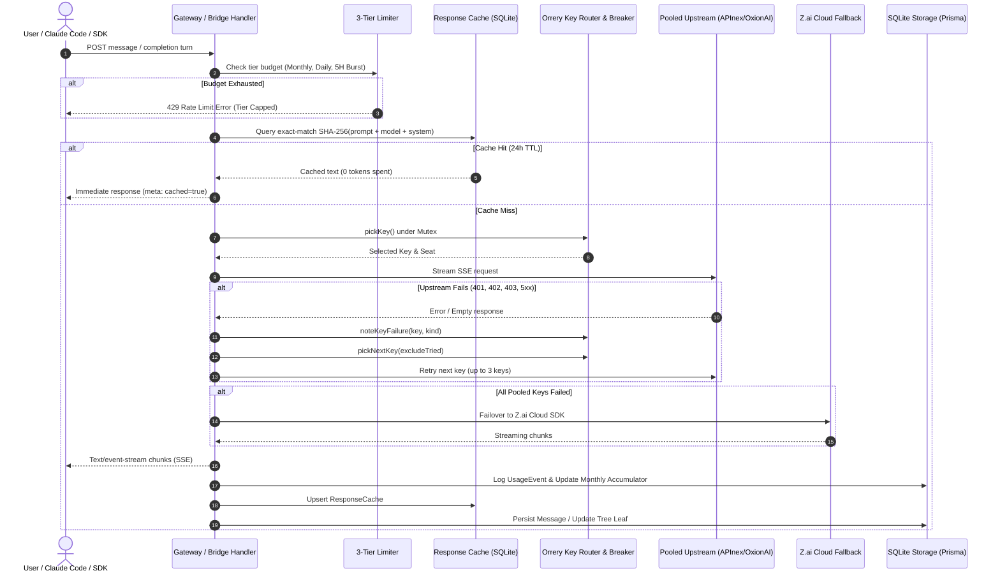
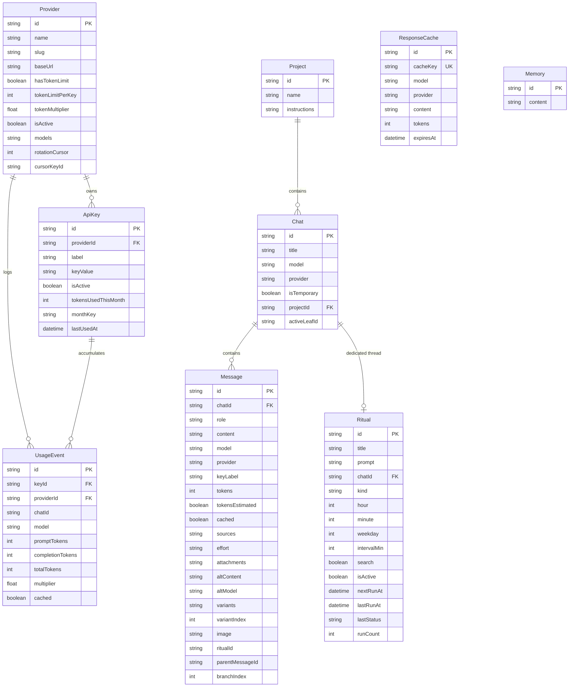
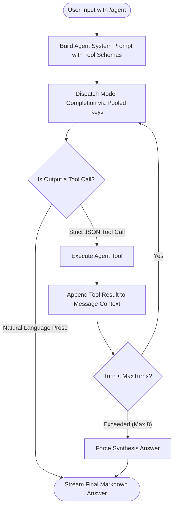
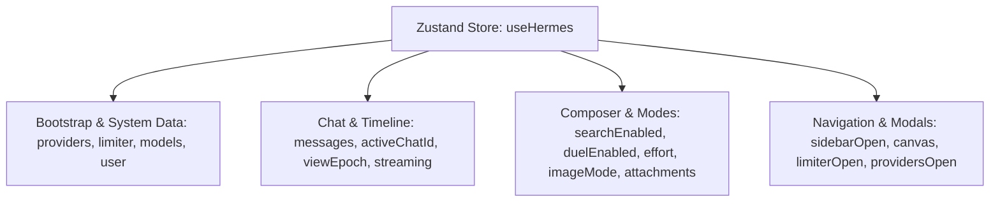

# Hermes — The Personal AI Gateway & Intelligent Workspace
### Complete Deep-Dive Architectural Specification & Developer Handbook

> **Version:** 0.2.1  
> **Repository:** `~/senku/ClaudeCode/OpenSource/New`  
> **Status:** Production-Ready Personal AI Gateway (43+ Continuous Improvement Runs)  
> **Tech Stack:** Next.js 16 (App Router), React 19, TypeScript 5, Tailwind CSS 4, Prisma ORM, SQLite, Zustand, Radix UI, Bun runtime.

---

## Table of Contents

1. [Executive Overview & Core Identity](#1-executive-overview--core-identity)
2. [High-Level Architecture & System Data Flow](#2-high-level-architecture--system-data-flow)
3. [Database Schema & Domain Models (Prisma & SQLite)](#3-database-schema--domain-models-prisma--sqlite)
4. [Routing, Key Management & The Living Pool](#4-routing-key-management--the-living-pool)
   - [The Orrery & The Fair Ring (Persistent Cursor & Anti-Drift)](#the-orrery--the-fair-ring)
   - [Self-Healing Circuit Breaker & Living Pool Prober](#self-healing-circuit-breaker--living-pool-prober)
5. [Token Accounting & The 3-Tier Limiter](#5-token-accounting--the-3-tier-limiter)
6. [Conversation Trees & Message Branching (The Fork)](#6-conversation-trees--message-branching-the-fork)
7. [External API Compatibility Bridges (OpenAI & Anthropic)](#7-external-api-compatibility-bridges-openai--anthropic)
   - [OpenAI Bridge (`/v1/chat/completions`)](#openai-bridge)
   - [Anthropic Messages Bridge (`/v1/messages` — Claude Code CLI Support)](#anthropic-messages-bridge)
8. [The Exocore: Agent Orchestrator & Tool Registry](#8-the-exocore-agent-orchestrator--tool-registry)
9. [Multimodal & Interactive Engines](#9-multimodal--interactive-engines)
   - [Image Forge (Text-to-Image & Gallery)](#image-forge)
   - [Hermes Canvas & Sandboxed JS Execution](#hermes-canvas--sandboxed-js-execution)
   - [Voice Interface (ASR & TTS)](#voice-interface)
   - [Grounding & Web Search Pipeline](#grounding--web-search-pipeline)
   - [Duel Racing Engine](#duel-racing-engine)
10. [Frontend Architecture & State Machine (Zustand & Components)](#10-frontend-architecture--state-machine)
11. [Developer Cookbook: How to Build, Add, Modify & Improve](#11-developer-cookbook)
    - [Prerequisites & Development Setup](#prerequisites--development-setup)
    - [Recipe 1: Adding a New AI Model](#recipe-1-adding-a-new-ai-model)
    - [Recipe 2: Adding a New AI Provider](#recipe-2-adding-a-new-ai-provider)
    - [Recipe 3: Adding a New Agent Tool](#recipe-3-adding-a-new-agent-tool)
    - [Recipe 4: Adding a New Canvas Preview Language](#recipe-4-adding-a-new-canvas-preview-language)
    - [Recipe 5: Modifying the Database Schema](#recipe-5-modifying-the-database-schema)
    - [Recipe 6: Pointing Claude Code CLI to Hermes](#recipe-6-pointing-claude-code-cli-to-hermes)
12. [Testing, Health Probes & Verification Suite](#12-testing-health-probes--verification-suite)
13. [File Tree & Architectural Map](#13-file-tree--architectural-map)

---

## 1. Executive Overview & Core Identity

**Hermes** (initially developed under the moniker *SenkuAPI* and rebranded in Run 32) is a self-hosted, personal AI gateway and high-performance conversational workspace. Unlike standard web UIs that bind to a single third-party API key or run heavy local weights, Hermes acts as a **smart intermediate orchestrator**:

* **Zero Local Model Execution:** 100% of LLM inference is handled in the cloud across pooled provider keys (APInex, OxionAI) with automatic, transparent failover to the Z.ai cloud SDK runtime (`z-ai-web-dev-sdk`).
* **Self-Healing Key Ring:** Pooled API keys rotate via round-robin with persistent database cursors, anti-drift balancing, and an automated background health prober that quarantines dead/suspended keys (401/403/402) before users ever hit them.
* **3-Tier Token Pacing:** Strict token budget controls enforce monthly allowances, daily pacing targets (computed against Africa/Algiers timezone `01:00 → 01:00`), and rolling 5-hour burst caps for token-limited tiers.
* **Non-Destructive Conversation Trees:** Conversations are trees, not tapes. Editing any turn creates a sibling branch (`parentMessageId`, `branchIndex`) without deleting old history, enabling full branch navigation (`‹ 1/3 ›`).
* **Universal API Dialect Bridge:** Hermes exposes standard `/v1/chat/completions` (OpenAI format) and `/v1/messages` (Anthropic format) endpoints. External CLIs like **Claude Code** can point directly to Hermes via `ANTHROPIC_BASE_URL="http://localhost:3000"`, enjoying pooled key failover and rate management transparently.
* **The Exocore Autonomous Agent:** A full ReAct agentic execution loop (`/api/agent/run`) equipped with live web search, safe math evaluation, gateway telemetry introspection, and the Jev AI ensemble model for arbitrating conflicting strategic decisions.
* **Embedded Sandbox Tools:** In-browser sandboxed JavaScript execution (opaque iframe with CSP `connect-src 'none'`), sanitized Mermaid diagram rendering, image generation, and audio transcription.

---

## 2. High-Level Architecture & System Data Flow

The following sequence illustrates the complete lifecycle of a turn, whether originating from the React Web UI, an OpenAI SDK client, or the Claude Code CLI:



### Self-Healing SQLite Pool
In [src/lib/db.ts](src/lib/db.ts), the Prisma database client implements an automatic self-healing wrapper. If external operations (such as git branch switches, stash restores, or backups) replace the SQLite file while the server is running, SQLite connections throw `SqliteError "attempt to write a readonly database"`. Hermes intercepts this specific error, forcibly disconnects the Prisma pool, and reconnects on the next tick, preventing the gateway from staying permanently read-only.

### Background Instrumentation
Next.js server instrumentation ([src/instrumentation.ts](src/instrumentation.ts)) registers two core background daemons at boot:
1. `startRitualScheduler()`: Checks and fires scheduled prompt rituals on their defined cron/interval schedule.
2. `startPoolProber()`: Background worker probing API keys every 30 seconds to update live health status and self-heal returned keys.

---

## 3. Database Schema & Domain Models (Prisma & SQLite)

The database schema is defined in [prisma/schema.prisma](prisma/schema.prisma) and stored in SQLite at `db/custom.db` (configured via `DATABASE_URL` in `.env`).



### Key Models Deep-Dive

#### `Provider`
* Represents an upstream inference service. Exactly **one** provider is marked `isActive = true` at any time.
* `OxionAI`: Token-limited tier (500,000 tokens/key/month, 3-tier pacing enforcement).
* `APInex`: Unlimited tier (`hasTokenLimit = false`, token usage multiplier `4.0`).
* `rotationCursor`: Integer pointer into the active keys list for round-robin dispatch.
* `cursorKeyId`: The **Key-Anchored Cursor** (Run 42). A stable reference to the next serving key ID that survives pool mutations (adding, deleting, or disabling keys).

#### `ApiKey`
* Represents a secret pooled key belonging to a provider.
* `tokensUsedThisMonth`: Monthly rolling token counter.
* `monthKey`: Format `"YYYY-MM"`. Automatically reset when the calendar month flips.

#### `Project`
* Acts as a workspace folder for chats.
* Contains `instructions`: Custom system prompt directive injected into every turn of every chat belonging to the project. Editing instructions automatically changes the system prompt, thus naturally invalidating stale cached entries in `ResponseCache`.
* Deleting a project does **not** delete its chats (`onDelete: SetNull`); unfiled chats simply move to "Recent".

#### `Chat` & `Message` (The Tree Engine)
* Messages form an acyclic directed tree rooted in the chat.
* `parentMessageId`: Points to the immediate parent message. If null, it is a root message.
* `branchIndex`: Sibling sequence index (0 for first edit, 1 for second edit, etc.).
* `activeLeafId`: Stored on `Chat`. Tracks the deepest message of the branch currently being displayed in the timeline.
* `variants`: JSON array of previous responses for regenerated turns, preserving complete metadata and receipts.
* `altContent` & `altModel`: Stores the losing runner-up response from a Duel mode turn.
* `image`: JSON `ImageRef` storing generated image dimensions, file path, prompt, and generation time.
* `ritualId`: Non-null if the turn was triggered by an automated Ritual run.

#### `UsageEvent` & `ResponseCache`
* Every non-cached LLM request records a `UsageEvent` capturing raw prompt/completion tokens and effective multiplier.
* `ResponseCache` stores exact matches (`sha256(JSON([prompt, model, systemPrompt]))`) with a 24-hour TTL.

---

## 4. Routing, Key Management & The Living Pool

The key management subsystem is located in [src/lib/hermes/router.ts](src/lib/hermes/router.ts), [src/lib/hermes/keyhealth.ts](src/lib/hermes/keyhealth.ts), [src/lib/hermes/pool.ts](src/lib/hermes/pool.ts), and [src/lib/hermes/ring.ts](src/lib/hermes/ring.ts).

### The Orrery & The Fair Ring

1. **Persistent Round-Robin:**
   Keys are ordered by `createdAt ASC` (canonical ring seats). The active seat pointer is tracked in database field `rotationCursor` and anchored by `cursorKeyId`.
2. **Atomic Seat Reservation:**
   Concurrent requests (e.g. multi-user streaming or parallel CLI operations) execute key selection under a promise-chain mutex, ensuring concurrent turns each reserve distinct seats and avoid dogpiling a single key.
3. **Anti-Drift Balancing:**
   For token-limited providers, if token spend spreads unevenly across keys, the router calculates `driftPct` and gently steers selection toward under-utilized keys.
4. **The Ring Ledger (`ring.ts`):**
   A global in-memory ledger recording confirmed key serves (`keyId`, `label`, `seat`, `tokens`, `model`, `at`). The UI displays these live serves in the Orrery cockpit.
5. **Ring Rehearsal (`/api/usage/rehearse`):**
   A dry-run simulator endpoint that executes test picks without advancing the live rotation cursor, returning a step-by-step audit of why seats would be picked or skipped.

### Self-Healing Circuit Breaker & Living Pool Prober

#### Failure Taxonomy
The circuit breaker in `keyhealth.ts` classifies errors into three distinct states:
* `checkin` (HTTP 402): Upstream requires dashboard daily check-in. Key receives 1 strike and is quarantined for **10 minutes**.
* `auth` (HTTP 401 / 403): Invalid or suspended credential. Key receives 1 strike and is quarantined for **10 minutes**.
* `transient` (HTTP 429, 5xx, or empty network stream): Requires 2 strikes within 5 minutes, resulting in a **60-second cooldown**.

#### The Background Prober (`pool.ts`)
* Arms at boot via `src/instrumentation.ts`.
* Every **30 seconds**, it executes a lightweight liveness test (`max_tokens: 1`) on unproven or cooldown-expired keys.
* If a key returns `200 OK`, it immediately re-enters the active rotation (`noteKeySuccess`).
* If a key returns `402`, it is marked as `checkin` before real user traffic ever encounters it.
* Healthy keys undergo keep-alive checks every **10 minutes**.
* Probes never count toward the user's token usage ledger (`countServe: false`).

#### Last-Resort Single Probe
When all keys in a pool are quarantined, `pickKey()` hands out one key marked with `lastResort: true`. If this key fails deterministically, the dispatcher aborts immediately and routes to the Z.ai cloud fallback, avoiding multiple slow timeout cycles.

---

## 5. Token Accounting & The 3-Tier Limiter

The token pacing engine is defined in [src/lib/hermes/limiter.ts](src/lib/hermes/limiter.ts).

### Unlimited vs Token-Limited Providers
* **APInex:** `hasTokenLimit = false`. Pacing limiter never blocks. Usage is tracked with a `4.0x` multiplier for informational reporting.
* **OxionAI:** `hasTokenLimit = true`. Token budget is enforced strictly across three temporal tiers.

### The Three Tiers (for Token-Limited Providers)

| Tier | Window / Basis | Calculation | Threshold Action |
| :--- | :--- | :--- | :--- |
| **Tier 1: Monthly Pool** | Calendar Month (Reset on 1st of month) | $500{,}000 \times \text{activeKeys}$ | Blocks all requests if monthly accumulator $\ge \text{Limit}$. |
| **Tier 2: Daily Pace** | Usage Day ($01{:}00 \to 01{:}00$ `Africa/Algiers`) | $\frac{\text{Monthly Pool}}{30}$ per day | Soft/hard pace status alerting; enforces daily budget. |
| **Tier 3: 5H Burst** | Rolling 5-Hour Time Window | $2 \times \text{Hourly Average Pace}$ | Prevents rapid exhaustion from automated scripts or bursts. |

### Pacing Status States
The limiter returns a computed `PaceStatus`:
* `unlimited`: Provider has no limit.
* `on-track`: Usage ratio is healthy and within target pacing.
* `steady`: Moderate consumption rate.
* `high-pace`: Approaching daily or 5-hour burst thresholds.
* `exhausted`: Cap reached on one or more tiers; requests blocked until window rollover.

---

## 6. Conversation Trees & Message Branching (The Fork)

Located in [src/lib/hermes/tree.ts](src/lib/hermes/tree.ts), Hermes implements a full tree model for chats (Run 39: "THE FORK").

```
             [Message 1: User]
                     │
            [Message 2: Assistant]
                     │
            [Message 3: User]
             /               \
   [Message 4a: Assist]   [Message 4b: Assist (Edited)]
           │                       │
   [Message 5a: User]      [Message 5b: User]
```

### Tree Invariants & Mechanics
1. **Never Overwrite:** When a user edits a message or regenerates an assistant response, the original message is **never deleted**. A new message row is created with the same `parentMessageId` and an incremented `branchIndex`.
2. **Active Leaf Pointer:** The `Chat.activeLeafId` column stores the message ID representing the tip of the currently active branch.
3. **Path Resolution (`resolveActivePath`):** To render the timeline, the engine starts at `activeLeafId` and traverses up through `parentMessageId` until reaching the root, ordering messages chronologically for display.
4. **Linear Era Backwards Compatibility (`linkLinearEra`):** Chats created prior to the branching engine have `parentMessageId = null`. When loaded, Hermes automatically chains them sequentially by `createdAt`, requiring zero destructive database migrations.
5. **Timeline Branch Controls:** In [src/components/hermes/ChatTimeline.tsx](src/components/hermes/ChatTimeline.tsx), messages with siblings display branch switchers (`‹ 1/3 ›`), allowing users to switch branches at any split point.

---

## 7. External API Compatibility Bridges (OpenAI & Anthropic)

Hermes allows external tools, IDE extensions, and CLIs to interact with its pooled provider keys.

### OpenAI Bridge
* **Endpoint:** `POST /v1/chat/completions` (and `/api/v1/chat/completions`)
* **Source:** [src/app/v1/chat/completions/route.ts](src/app/v1/chat/completions/route.ts)
* **Functionality:** Accepts standard OpenAI payload formats. Supports raw JSON and SSE streaming (`text/event-stream`). Automatically retries failed upstream pooled keys inside the same open HTTP connection before falling back to the cloud.

### Anthropic Messages Bridge
* **Endpoint:** `POST /v1/messages`
* **Source:** [src/app/v1/messages/route.ts](src/app/v1/messages/route.ts) and [src/lib/hermes/anthropic-bridge.ts](src/lib/hermes/anthropic-bridge.ts)
* **Purpose:** Enables tools configured for Anthropic (such as **Claude Code CLI**) to use Hermes directly.

#### Translation Specification

| Anthropic Concept | Transformed To (OpenAI Upstream) | Returned To Anthropic Client |
| :--- | :--- | :--- |
| `system: string \| Block[]` | System prompt message (`role: "system"`) | Handled internally |
| `role: "user"`, content blocks | Text content merged into user message | Message start / Content delta |
| `tool_use` block | `tool_calls` array in assistant message | `content_block_start(type: "tool_use")` |
| `tool_result` block | Message with `role: "tool"` & `tool_call_id` | Tool execution completed |
| `tools: [{ input_schema }]` | OpenAI `functions` schema format | Tool definitions passed through |
| SSE Stream Format | Translates OpenAI `data: { choices: [...] }` | `message_start` $\to$ `content_block_delta` $\to$ `message_stop` |

---

## 8. The Exocore: Agent Orchestrator & Tool Registry

Located in [src/lib/agent/orchestrator.ts](src/lib/agent/orchestrator.ts) and [src/lib/agent/tools/index.ts](src/lib/agent/tools/index.ts), the **Exocore** is Hermes's autonomous ReAct agent loop.



### Agent Tool Contract
Tools implement the `AgentTool` interface:
```typescript
export interface AgentTool {
  name: string;
  description: string;
  parameters: Record<string, unknown>; // JSON Schema
  execute(args: Record<string, unknown>): Promise<ToolOutcome>;
}
```

### Registered Tools
1. `web_search`: Executes live search via DuckDuckGo HTML/Lite with fallback to Z.ai cloud search. Clamps results to 3 dated snippets ($\le 300$ characters).
2. `calculator`: Evaluates mathematical expressions using a locked character whitelist (`safeMathEvaluate`), preventing arbitrary code injection while supporting trigonometric, logarithmic, and power functions.
3. `system_status`: Inspects live gateway telemetry: active provider, rotation cursor, key health statuses, token usage in the last 24h, and total chat counts.
4. `jev_decide`: Invokes the Jev AI ensemble model (`free/jev-1.13`) to arbitrate between 2 to 8 conflicting options according to user-defined criteria.

---

## 9. Multimodal & Interactive Engines

### Image Forge
* **Server Logic:** [src/lib/hermes/imagegen.ts](src/lib/hermes/imagegen.ts), [src/lib/hermes/image-forge.ts](src/lib/hermes/image-forge.ts)
* **Gallery UI:** [src/components/hermes/ImageGallery.tsx](src/components/hermes/ImageGallery.tsx)
* **Mechanics:** Calls `z-ai-web-dev-sdk` image generation engine. Images are decoded and stored on disk in `generated-images/` (named `img-<timestamp>-<hash>.<ext>`). Only the metadata reference (`ImageRef` JSON) is saved in the database.
* **Supported Aspect Ratios:** `square` (1024x1024), `portrait` (768x1024), `landscape` (1024x768), `wide` (1280x720).

### Hermes Canvas & Sandboxed JS Execution
* **Canvas Panel:** [src/components/hermes/CanvasPanel.tsx](src/components/hermes/CanvasPanel.tsx)
* **Sandboxed Runner:** [src/lib/hermes/js-runner.ts](src/lib/hermes/js-runner.ts)
* **Preview Languages:** `html`, `svg`, `mermaid`, `javascript`, `python` (view-only).
* **Security Model:**
  * Previews render inside a `srcdoc` iframe with an **empty** `sandbox` attribute (disallowing scripts, same-origin access, forms, and popups).
  * Strict Content Security Policy (CSP): `default-src 'none'; style-src 'unsafe-inline'; img-src data: blob:;`.
  * **Interactive JavaScript Execution:** Runnable code executes inside an isolated iframe with `sandbox="allow-scripts"` (opaque origin) and CSP `connect-src 'none'`. System calls (`fetch`, `XMLHttpRequest`, `WebSocket`) are shadowed with throwing stubs. Console logs (`log`, `warn`, `error`, `table`) stream back to the parent window via `postMessage`. A **5-second hard timeout** terminates runaway loops.

### Voice Interface
* **Audio Processing:** [src/lib/voice/audio.ts](src/lib/voice/audio.ts)
* **Voice Component:** [src/components/hermes/VoiceInterface.tsx](src/components/hermes/VoiceInterface.tsx)
* **Mechanics:** Records browser audio via `MediaRecorder`. Resamples audio client-side using `OfflineAudioContext` into standard 16 kHz mono WAV.
* Transcriptions run via `/api/voice/transcribe`; text-to-speech runs via `/api/voice/speak`.

### Grounding & Web Search Pipeline
* **Source:** [src/lib/hermes/search.ts](src/lib/hermes/search.ts) and [src/lib/hermes/grounding.ts](src/lib/hermes/grounding.ts)
* **Anti-Hallucination Directives:** Without search results, models are instructed via system directives to admit knowledge cutoff limits rather than invent release versions or dates.
* **Grounding Contract:** When search is active, the engine extracts publication dates, audits authority tiers (official > news > blog > forum/social), and requires the model to state confidence ratings (`[confirmed]`, `[partial]`, or `[stale sources]`).

### Duel Racing Engine
* Arming Duel mode races two models simultaneously on the same prompt (e.g. `GLM 5.3` vs `Gemini 3.8 Flash`).
* The UI displays streams side-by-side. The user selects the winning answer; the chosen response becomes the primary message, while the runner-up is saved in `altContent` and `altModel` for reference.

---

## 10. Frontend Architecture & State Machine

Hermes uses a single centralized Zustand store defined in [src/lib/store.ts](src/lib/store.ts).

### State Topology (`useHermes`)



### Component Hierarchy

```
src/components/hermes/
├── HermesApp.tsx              # Root shell layout, drawer states, keyboard shortcuts (⌘K)
├── Sidebar.tsx                # Left navigation: Project folders, recent chats, user menu
├── TopBar.tsx                 # Header: Sidebar toggle, model indicator, token pill, project tag
├── WelcomeScreen.tsx          # Initial view: Sparkle canvas, Living Medallion, prompt starters
├── SparkleField.tsx           # Interactive particle canvas reacting to pointer moves and clicks
├── ChatTimeline.tsx           # Message feed, branch switcher (‹ k/N ›), duel lane views, variants
├── Markdown.tsx               # Markdown formatting, syntax highlighting, runnable JS blocks
├── Typewriter.tsx             # Smooth streaming text renderer using RAF throttling
├── InputBar.tsx               # Chat input composer, slash commands (/agent, /image, /search), file chips
├── CanvasPanel.tsx            # Split-screen tools: HTML, SVG, Mermaid, Sandboxed JS console
├── CommandPalette.tsx         # ⌘K / Ctrl+K modal: Full-text message search across SQLite
├── ProvidersDialog.tsx        # The Orrery cockpit: Key rotation visualizer & health monitors
├── TokenLimiterDialog.tsx     # 3-tier pacing limiter statistics and usage reset details
├── MemoryDialog.tsx           # Global memory management dialog
├── ProjectsDialog.tsx         # Project creation and system prompt instructions editor
├── RitualsDialog.tsx          # Scheduled prompt manager (daily/weekly/interval configurations)
├── ImageGallery.tsx           # Full-screen grid viewer for forged images
└── VoiceInterface.tsx         # Full-screen hands-free voice conversation modal
```

---

## 11. Developer Cookbook

### Prerequisites & Development Setup

1. **Prerequisites:**
   * **Bun** ($\ge 1.1$) or **Node.js** ($\ge 20$)
   * **Python 3** (for the automated test suite)
   * **SQLite3**

2. **Installation:**
   ```bash
   cd ~/senku/ClaudeCode/OpenSource/New
   bun install
   ```

3. **Database Initialization:**
   ```bash
   bun run db:generate
   bun run db:push
   ```

4. **Starting the Dev Server:**
   ```bash
   bun run dev
   # Accessible at http://localhost:3000
   ```

---

### Recipe 1: Adding a New AI Model

To register a new model (e.g., adding `free/mistral-large-3` to APInex):

1. **Add Model ID to Constants:**
   Open [src/lib/hermes/constants.ts](src/lib/hermes/constants.ts) and add the model string to `APINEX_MODELS`:
   ```typescript
   export const APINEX_MODELS = [
     "free/glm-5.3",
     "free/gemini-3.8-flash",
     "free/mistral-large-3", // <-- Added
     // ...
   ];
   ```

2. **Add Display Metadata & Badge Info:**
   Open [src/lib/hermes/models.ts](src/lib/hermes/models.ts) and add the configuration to `KNOWN`:
   ```typescript
   "free/mistral-large-3": { 
     name: "Mistral Large 3", 
     tier: "Free", 
     note: "General reasoning" 
   },
   ```

3. **Update Active Provider Record in Database:**
   Trigger model sync by hitting `GET /api/models?sync=1` or updating the active provider row in SQLite:
   ```bash
   bunx prisma studio
   ```

---

### Recipe 2: Adding a New AI Provider

To add an upstream provider (e.g. `Groq` or `DeepInfra`):

1. **Update Seed Data:**
   Open [src/lib/hermes/seed.ts](src/lib/hermes/seed.ts) and add an upsert call for your new provider:
   ```typescript
   const groq = await db.provider.upsert({
     where: { slug: "groq" },
     create: {
       name: "Groq",
       slug: "groq",
       baseUrl: "https://api.groq.com/openai/v1",
       hasTokenLimit: true,
       tokenLimitPerKey: 1000000,
       tokenMultiplier: 1.0,
       isActive: false,
       models: JSON.stringify(["llama-3.3-70b-versatile"]),
     },
     update: {
       baseUrl: "https://api.groq.com/openai/v1",
     },
   });
   ```

2. **Configure API Base URL in Constants:**
   Define `GROQ_BASE_URL` in [src/lib/hermes/constants.ts](src/lib/hermes/constants.ts).

3. **UI Switching:**
   Providers can be activated through the **Manage Providers** dialog in the web UI.

---

### Recipe 3: Adding a New Agent Tool

To add a tool to the Exocore Agent (e.g., a `weather_lookup` tool):

1. **Define Tool in [src/lib/agent/tools/index.ts](src/lib/agent/tools/index.ts):**
   ```typescript
   const weatherTool: AgentTool = {
     name: "weather_lookup",
     description: "Get real-time weather information for a specified city.",
     parameters: {
       type: "object",
       properties: {
         city: { type: "string", description: "City name, e.g. London, Tokyo" }
       },
       required: ["city"]
     },
     async execute(args) {
       const city = String(args.city || "").trim();
       if (!city) {
         return { summary: "weather — missing city", detail: "ERROR: city is required" };
       }
       // Fetch weather or query external service
       const temp = "21°C, Clear";
       return {
         summary: `weather_lookup("${city}") → ${temp}`,
         detail: `Current weather in ${city}: ${temp}`
       };
     }
   };
   ```

2. **Register in Tool Registry:**
   In `src/lib/agent/tools/index.ts`, append `weatherTool` to the exported array:
   ```typescript
   export const AGENT_TOOLS: AgentTool[] = [
     webSearchTool,
     calculatorTool,
     systemStatusTool,
     jevDecideTool,
     weatherTool, // <-- Added
   ];
   ```
   The orchestrator will automatically register the schema and route tool execution calls.

---

### Recipe 4: Adding a New Canvas Preview Language

To add rendering support for a new language (e.g., `graphviz` or `dot`):

1. **Register Language Identifier:**
   Open [src/lib/hermes/canvas-langs.ts](src/lib/hermes/canvas-langs.ts):
   ```typescript
   export const PREVIEW_LANGS = [
     "html",
     "svg",
     "mermaid",
     "javascript",
     "python",
     "graphviz", // <-- Added
   ] as const;

   const ALIASES: Record<string, PreviewLang> = {
     // ...
     dot: "graphviz",
     graphviz: "graphviz",
   };
   ```

2. **Implement Preview Renderer:**
   In [src/components/hermes/CanvasPanel.tsx](src/components/hermes/CanvasPanel.tsx), add a render branch inside `renderPreviewContent()` handling `"graphviz"`.

---

### Recipe 5: Modifying the Database Schema

1. Edit [prisma/schema.prisma](prisma/schema.prisma) to add your models or columns.
2. Push changes to the SQLite database:
   ```bash
   bun run db:push
   ```
3. Generate the updated Prisma client:
   ```bash
   bun run db:generate
   ```

---

### Recipe 6: Pointing Claude Code CLI to Hermes

Hermes provides native support for Claude Code CLI using the `/v1/messages` bridge:

```bash
# Terminal 1: Ensure Hermes server is running
cd ~/senku/ClaudeCode/OpenSource/New
bun run dev

# Terminal 2: Configure Anthropic SDK / Claude Code to use Hermes
export ANTHROPIC_BASE_URL="http://localhost:3000"
export ANTHROPIC_API_KEY="hermes-local-key" # Any non-empty string

# Launch Claude Code
claude
```
Claude Code commands and tool usages will route through Hermes's active key pool with circuit breaker and failover protections.

---

## 12. Testing, Health Probes & Verification Suite

Hermes includes a Python 3 test harness in [tests/test_hermes.py](tests/test_hermes.py).

### Running the End-to-End Test Suite

Ensure the local server is running on `localhost:3000`, then execute:

```bash
bun run test:hermes
# or directly:
python3 tests/test_hermes.py
```

### What the Test Suite Verifies:
1. **Bootstrap & System Status:** Probes `/api/bootstrap` to verify active providers, models, and usage counters.
2. **Chat Lifecycle:** Tests conversation creation, streaming generation (SSE validation), and title generation.
3. **Response Caching (Nonce Integrity):** Sends duplicate turns with unique run nonces to verify 0-token cache hits and response times under 20ms.
4. **Conversation Branching (The Fork):** Verifies sibling creation and branch leaf switching via `/api/chat/branch` and `/api/chat/leaf`.
5. **OpenAI Compatibility Bridge:** Directly tests `POST /v1/chat/completions` in JSON and streaming modes.
6. **Anthropic Compatibility Bridge:** Directly tests `POST /v1/messages` with content blocks and tool signatures.
7. **Agent Exocore Execution:** Tests `/api/agent/run` ReAct tool execution with the math calculator and web search.
8. **3-Tier Token Limiter:** Inspects `/api/usage` and checks daily rollover calculations against the Africa/Algiers timezone.

---

## 13. File Tree & Architectural Map

```
.
├── Caddyfile                          # Reverse proxy config for port mapping and SSL
├── components.json                    # Shadcn UI configuration
├── package.json                       # Scripts and project dependencies
├── next.config.ts                     # Standalone Next.js output and runtime options
├── tailwind.config.ts                 # Tailwind configuration
├── tsconfig.json                      # Path aliases (@/* -> ./src/*)
├── prisma/
│   └── schema.prisma                  # SQLite schema definition
├── db/
│   └── custom.db                      # SQLite database storage file
├── generated-images/                  # Local storage directory for forged images
├── tests/
│   └── test_hermes.py                 # Comprehensive E2E Python verification test suite
├── scripts/
│   ├── gen-pwa-icons.mjs              # Generator script for PWA icons
│   └── obs-usage-window.mjs           # Utility script for inspecting usage counters
├── src/
│   ├── instrumentation.ts             # Boot hook for Rituals scheduler & Pool prober
│   ├── app/
│   │   ├── layout.tsx                 # Root layout with theme and font definitions
│   │   ├── page.tsx                   # Main entry point mounting HermesApp
│   │   ├── globals.css                # Tailwind 4 styling and theme color definitions
│   │   ├── v1/
│   │   │   ├── chat/completions/      # OpenAI compatible endpoint
│   │   │   ├── messages/              # Anthropic compatible endpoint
│   │   │   └── models/                # Available models listing endpoint
│   │   └── api/
│   │       ├── bootstrap/             # App initialization and initial state payload
│   │       ├── chat/
│   │       │   ├── send/              # Main chat turn SSE streaming route
│   │       │   ├── branch/            # Branch creation and fork management
│   │       │   ├── fork/              # Fork turn action
│   │       │   ├── leaf/              # Set active branch leaf
│   │       │   └── duel/pick/         # Record user choice in Duel mode
│   │       ├── agent/run/             # Exocore ReAct agent loop
│   │       ├── memory/                # Persistent memory CRUD
│   │       ├── rituals/               # Scheduled rituals management
│   │       ├── projects/              # Project folders & prompt instructions
│   │       ├── providers/             # Key pool & provider management
│   │       ├── usage/                 # Limiter status & rehearsal endpoints
│   │       └── image/generate/        # Text-to-image forge endpoint
│   ├── lib/
│   │   ├── db.ts                      # Prisma client with self-healing SQLite pool
│   │   ├── store.ts                   # Zustand application state store
│   │   ├── agent/
│   │   │   ├── orchestrator.ts        # ReAct agent loop implementation
│   │   │   ├── decisions.ts           # Jev AI ensemble arbitrator
│   │   │   └── tools/                 # Tool definitions (web_search, calculator, status)
│   │   └── hermes/
│   │       ├── router.ts              # Key selection, persistent cursors, anti-drift
│   │       ├── keyhealth.ts           # Circuit breaker failure states & quarantines
│   │       ├── pool.ts                # Background key prober daemon
│   │       ├── ring.ts                # Confirmed serve ledger tracking
│   │       ├── limiter.ts             # 3-tier pacing limiter calculations
│   │       ├── tree.ts                # Message branching and path resolution
│   │       ├── dispatch.ts            # Key retry dispatch and failover handling
│   │       ├── executor.ts            # Upstream HTTP streaming and token estimation
│   │       ├── cache.ts               # Exact-match response caching
│   │       ├── anthropic-bridge.ts    # Anthropic Messages <-> OpenAI translator
│   │       ├── js-runner.ts           # Sandboxed JavaScript runner execution logic
│   │       ├── imagegen.ts            # Image generation engine via Z.ai SDK
│   │       └── search.ts              # Web search scraping and snippet extraction
│   └── components/
│       ├── ui/                        # Radix UI primitives & Shadcn components
│       └── hermes/                    # Application UI components (Timeline, Input, Dialogs)
```
