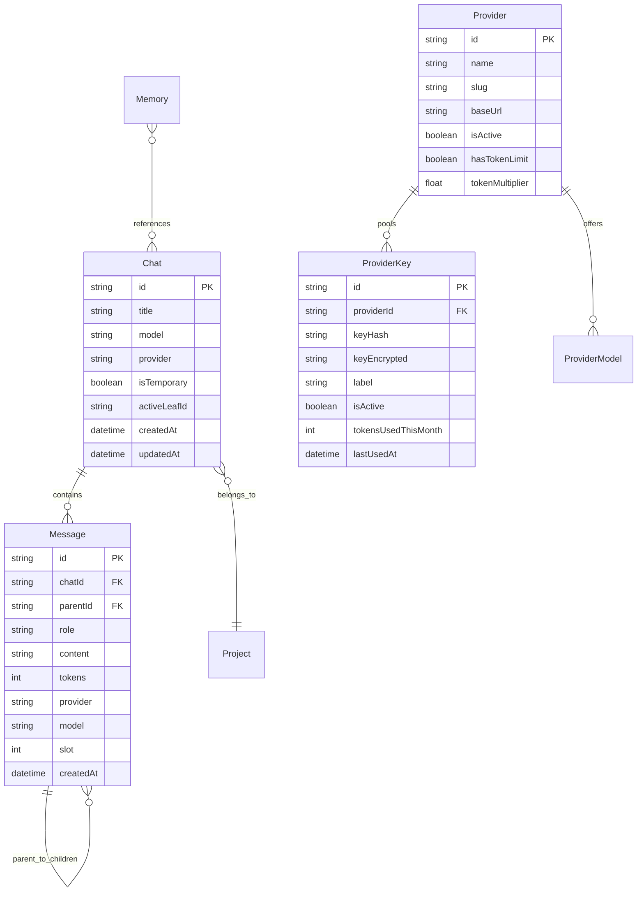
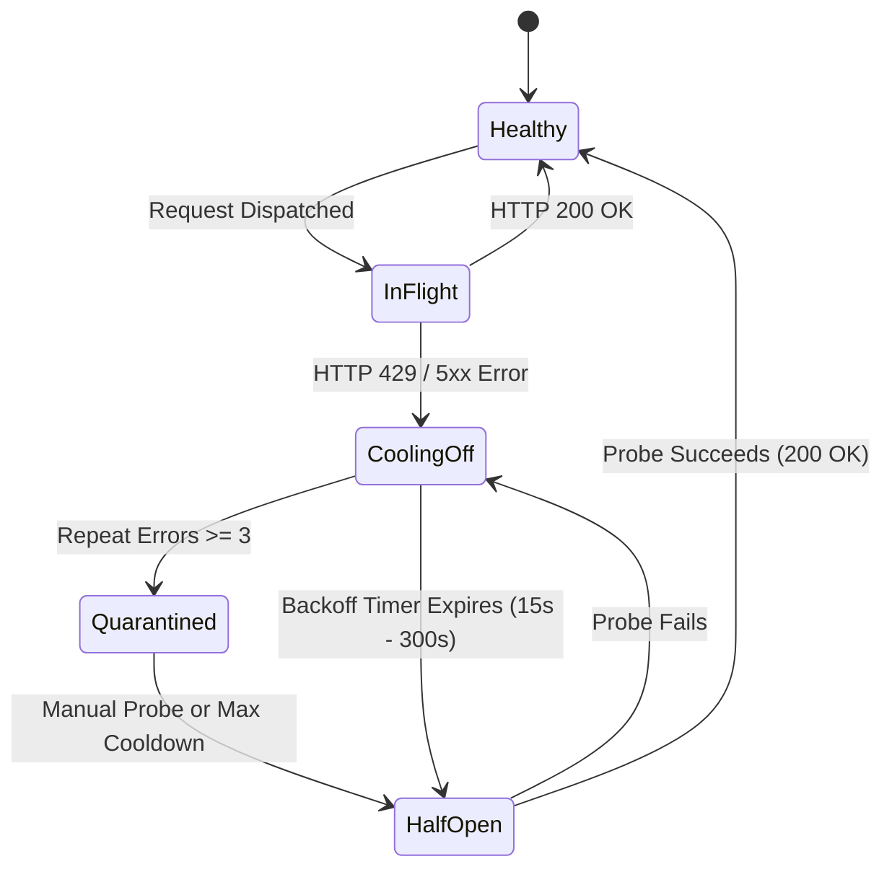

# SENKU ARCHITECTURAL SPECIFICATION & SYSTEM TOPOLOGY
**Version:** 1.0.0-alpha  
**Status:** Canonical Master Specification  
**Codename:** Senku Second Brain & Unified AI Gateway

---

## 1. Executive Summary & Vision

Senku is an open-source, high-performance, autonomous **Second Brain** and **Unified AI Gateway**. It bridges local privacy and zero-lock persistence with multi-provider upstream dispatch, autonomous agent orchestration, low-latency hands-free voice assistance ("Jarvis"), and zero-local-compute multimodal capabilities.

Originally conceived within containerized cloud sandboxes, Senku has been radically re-engineered into a decoupled, microservices-inspired topology that operates 100% locally with zero GPU overhead or proprietary container lock-ins.

```
                     +---------------------------------------+
                     |         Senku Web UI & Jarvis HUD      |
                     |  (Next.js App Router / React 19 / TS)  |
                     +-------------------+-------------------+
                                         |
     +-----------------------------------+-----------------------------------+
     |                                   |                                   |
+----+--------------------+     +-------+---------------+     +-------------+-----------+
|      core-gateway       |     |      brain-tree       |     |   senku-voice-jarvis    |
| - Key Orrery & Ring     |     | - Non-destructive Fork|     | - Continuous English ASR|
| - 3-Tier Limiter        |     | - SQLite Zero-Lock WAL|     | - Speech Synthesis      |
| - Exact-Match SHA-256   |     | - Path Resolution     |     | - Directive Classifier  |
| - OpenAI/Anthropic Wire |     | - Active Leaf Pointer |     | - Hands-free HUD Loop   |
+----+--------------------+     +-------+---------------+     +-------------+-----------+
     |                                   |                                   |
     +-----------------+                 |                 +-----------------+
                       |                 |                 |
                +------+-----------------+-----------------+------+
                |                                                 |
         +------+--------------------+                     +------+--------------------+
         |       exocore-agent       |                     |       forge-service       |
         | - Autonomous ReAct Loop   |                     | - Cloud-First Gen Engine  |
         | - DuckDuckGo / Wiki Ground|                     | - Pollinations Image Forge|
         | - Jev AI Decision Arbiter |                     | - Isolated Canvas Sandbox |
         | - Safe Math Parser        |                     | - Multi-Modal Attachment  |
         +---------------------------+                     +---------------------------+
```

---

## 2. Microservice Topology & Domain Decomposition

The monolith has been decomposed into five clean, decoupled domains residing under `src/services/` and accessible via typed interfaces.

### 2.1 `core-gateway` (`src/services/gateway/`)
The routing and upstream gateway handles multi-provider pooling, round-robin key rotation, rate pacing, exact SHA-256 stream caching, and external standard API bridges.

- **Primary Components:**
  - `src/services/gateway/index.ts`: Unified gateway facade implementing `CoreGatewayService`.
  - `src/lib/hermes/dispatch.ts`: Upstream network dispatch, streaming SSE generator, upstream error parsing.
  - `src/lib/hermes/keyhealth.ts`: Active key health registry, circuit breaker, exponential backoff (15s to 300s).
  - `src/lib/hermes/limiter.ts`: 3-Tier token pacing engine (Monthly, Daily, 5-Hour burst).
  - `src/lib/hermes/cache.ts`: Exact-match SHA-256 prompt hashing with zero-token <20ms returns.
- **Protocol Bridges:**
  - `POST /v1/chat/completions` & `/api/v1/chat/completions`: Full OpenAI dialect compliance.
  - `POST /v1/messages`: Anthropic Messages API dialect translation.

### 2.2 `brain-tree` (`src/services/tree/`)
Manages non-destructive conversation branching ("The Fork"), message graphs, path resolutions, and SQLite state persistence.

- **Primary Components:**
  - `src/services/tree/index.ts`: Brain tree domain service implementing `BrainTreeService`.
  - `src/lib/hermes/tree.ts`: Path traversal (`resolvePath`), sibling calculation (`siblingSlots`), branch mutations, and active leaf pointers.
  - `src/lib/db.ts`: SQLite self-healing connection layer with automatic WAL activation (`PRAGMA journal_mode = WAL;`, `PRAGMA synchronous = NORMAL;`, `PRAGMA busy_timeout = 5000;`).
- **Core Philosophy:** No message is ever destroyed during edits or regenerations; each branch forks into an immutable sibling path, preserving the complete cognitive trajectory.

### 2.3 `senku-voice-jarvis` (`src/services/voice/`)
Dedicated voice assistant engine and hands-free personal operator. Operates strictly in English with continuous low-latency recognition, automated silence detection, interrupt handling, and autonomous directive execution.

- **Primary Components:**
  - `src/services/voice/jarvis.ts`: `JarvisDispatcher` which classifies spoken English commands into direct responses, mathematical evaluations, Jev AI decision arbitration, or Exocore tool actions.
  - `src/app/api/voice/jarvis/route.ts`: Dedicated serverless directive endpoint returning `{ spokenText, markdownText, toolUsed, actionSummary, durationMs }`.
  - `src/components/hermes/JarvisCore.tsx`: Modern, immersive React client component with audio reactivity, silence detection (1200ms trigger), full speech synthesis (`SpeechSynthesisUtterance`), keyboard controls (`⌘J` / `Space`), and tool badge visualization.

### 2.4 `exocore-agent` (`src/services/agent/`)
The tool execution orchestrator and multi-turn ReAct runtime.

- **Primary Components:**
  - `src/services/agent/index.ts`: Agent facade implementing `ExocoreAgentService`.
  - `src/lib/agent/orchestrator.ts`: ReAct multi-turn loop executing queries with tool calls and context reflection.
  - `src/lib/hermes/tools.ts`: Tool execution engine including DuckDuckGo search, Wikipedia lookup, and safe arithmetic evaluation.
  - `src/lib/hermes/decisions.ts`: Jev AI ensemble arbitrator (`/v1/decisions` on `free/jev-1.13`) providing multi-model weighted conflict resolution.

### 2.5 `forge-service` (`src/services/multimodal/`)
Multimodal generation, visual canvas management, and zero-local-compute media synthesis.

- **Primary Components:**
  - `src/services/multimodal/index.ts`: Multimodal facade implementing `MultimodalService`.
  - `src/lib/hermes/imagegen.ts`: Cloud-first image forge leveraging Pollinations.ai cloud pipelines; generates, fetches, and writes images locally to `generated-images/` without requiring local GPU dependencies.
  - `src/lib/hermes/attachments.ts`: Document and text extraction for PDF, code, and markdown inputs.
  - `src/components/hermes/CanvasPanel.tsx`: Interactive sandboxed code execution runner.

---

## 3. Database Architecture & State Tree Mechanics

Senku stores all state in a zero-lock SQLite database managed via Prisma ORM.

### 3.1 Entity Relationship Diagram



### 3.2 The Fork: Non-Destructive Branching Algorithm

When a user edits an earlier message in a conversation:
1. Senku does **not** truncate or overwrite the subsequent messages.
2. A new `Message` node is appended whose `parentId` matches the edited message's parent.
3. The new node receives an incremented `slot` index among its siblings.
4. The conversation's `activeLeafId` is updated to point to the newly generated leaf node.
5. In the UI, sibling navigator buttons (`< 2/3 >`) allow users to seamlessly traverse alternate cognitive realities.

---

## 4. Key Management & Circuit Breaker State Machine

The Core Gateway maintains continuous upstream uptime through the **Orrery Ring** and **Key Health Circuit Breaker**.



- **Round-Robin Key Ring (`cursorKeyId`):** Active provider keys are rotated using a persistent cursor to ensure balanced quota consumption across accounts.
- **Zero-Token Cache:** Identical prompts are digested via SHA-256. Matching requests return instant zero-token responses, completely bypassing upstream rate limits.

---

## 5. Voice Core (Jarvis) Architecture

The `senku-voice-jarvis` subsystem enables a fully hands-free, intelligent assistant experience in modern browsers:

1. **Continuous English ASR:** Uses the browser's native `SpeechRecognition` / `webkitSpeechRecognition` API with `lang = "en-US"`, streaming real-time transcription deltas.
2. **Silence Auto-Trigger:** Listens for natural pauses; an idle window of 1,200ms automatically dispatches the accumulated transcript.
3. **Interrupt Handling:** When new user speech is detected while Jarvis is speaking, `window.speechSynthesis.cancel()` immediately cuts off audio synthesis.
4. **Autonomous Action Routing:**
   - **Math & Arithmetic:** Routed through the safe expression evaluator.
   - **Multi-Option Conflicts:** Routed through the Jev AI ensemble arbitrator.
   - **Tool Tasks & Web Grounding:** Executed via the Exocore ReAct agent loop.
   - **General Conversation:** Answered directly via the Core Gateway.
5. **HUD Controls:** Activated by pressing the dedicated Jarvis icon in the top bar, through the Command Palette (`⌘K` -> Jarvis), or via the global keyboard shortcut `⌘J`.

---

## 6. Directory Structure & Code Mapping

```
├── docs/
│   └── SENKU_ARCHITECTURE.md        # Master System Architecture Document
├── src/
│   ├── app/
│   │   ├── api/
│   │   │   ├── agent/run/           # ReAct Agent execution route
│   │   │   ├── bootstrap/           # Client configuration bootstrap
│   │   │   ├── chat/                # Chat, branching, and leaf routes
│   │   │   ├── decisions/           # Jev AI ensemble decision route
│   │   │   ├── image/generate/      # Pollinations image generation route
│   │   │   ├── search/              # DuckDuckGo web search endpoint
│   │   │   ├── usage/               # 3-tier token limiter telemetry
│   │   │   ├── voice/jarvis/        # Voice Core Jarvis directive route
│   │   │   └── voice/speak/         # TTS speech route
│   │   ├── layout.tsx               # Root application metadata & layout
│   │   └── page.tsx                 # Main application dashboard
│   ├── components/hermes/
│   │   ├── CanvasPanel.tsx          # Sandboxed code canvas & visualizer
│   │   ├── ChatTimeline.tsx         # Multi-branch chat renderer
│   │   ├── CommandPalette.tsx       # ⌘K Command interface
│   │   ├── HermesApp.tsx            # Main shell & hotkey manager
│   │   ├── JarvisCore.tsx           # Voice Core interactive Jarvis HUD
│   │   ├── TopBar.tsx               # Header, provider status, and Jarvis toggle
│   │   └── WelcomeScreen.tsx        # Zero-state conversation onboarding
│   ├── lib/
│   │   ├── db.ts                    # SQLite WAL connection layer
│   │   ├── hermes/
│   │   │   ├── cache.ts             # Exact-match SHA-256 prompt cache
│   │   │   ├── decisions.ts         # Jev AI arbitrator client
│   │   │   ├── dispatch.ts          # Core upstream HTTP & SSE dispatcher
│   │   │   ├── imagegen.ts          # Cloud-first image forge adapter
│   │   │   ├── keyhealth.ts         # Circuit breaker & key health state
│   │   │   ├── limiter.ts           # Token pacing & usage limiter
│   │   │   ├── search.ts            # DuckDuckGo fallback scraper
│   │   │   ├── tools.ts             # Built-in tool definitions & runner
│   │   │   └── tree.ts              # Tree branching algorithms
│   │   └── store.ts                 # Global reactive state (Zustand)
│   └── services/                    # Microservice Domain Layer
│       ├── agent/                   # exocore-agent
│       ├── gateway/                 # core-gateway
│       ├── multimodal/              # forge-service
│       ├── tree/                    # brain-tree
│       └── voice/                   # senku-voice-jarvis
└── tests/
    └── test_hermes.py               # Comprehensive E2E verification test harness
```

---

## 7. Open-Source Alpha Roadmap

### Phase 1: Core Decoupling (Alpha 1.0 - Completed)
- [x] Rebrand entire ecosystem to "Senku".
- [x] Decouple proprietary container SDKs (`z-ai-web-dev-sdk`).
- [x] Establish microservice domain layer in `src/services/`.
- [x] Implement the autonomous Jarvis Voice Core with English ASR and synthesis.
- [x] Configure SQLite zero-lock WAL mode.
- [x] Author canonical architectural specification.

### Phase 2: Gateway Expansion (Beta 1.1)
- [ ] Add direct Ollama / LM Studio local runtime endpoints.
- [ ] Implement Redis-backed distributed token caching for multi-node deployments.
- [ ] Add configurable Webhook notification handlers for long-running agent tasks.

### Phase 3: Exocore Autonomous Skills (v2.0)
- [ ] Plugin ecosystem for custom user-authored JavaScript/Python tools.
- [ ] Native vector memory store integration (ChromaDB / SQLite-VSS).
- [ ] Multi-turn multi-agent collaboration canvas.

---

## 8. Verification & Release Acceptance Criteria

A build is certified for release only when all of the following criteria are satisfied:

1. **Type Safety:** `bun x tsc --noEmit` exits with status `0` and 0 errors.
2. **Automated Test Suite:** `python3 tests/test_hermes.py` achieves 100% pass rate on all functional tests.
3. **Production Build:** `bun run build` generates static assets and server bundles without warning triggers.
4. **Jarvis End-to-End:** Spoken command execution via `POST /api/voice/jarvis` executes and returns `{ spokenText, markdownText }` in <3.0 seconds.
5. **Zero-Lock Database:** SQLite operates under WAL journal mode without busy lock contentions.
